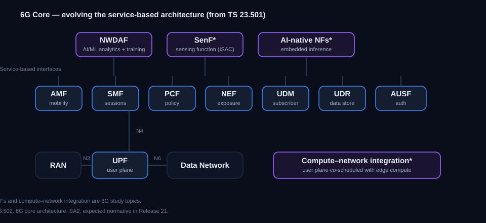

# 6G Core — The Next-Generation Core Network in 3GPP

See how the core network is set to evolve for 6G — the architecture study in 3GPP, how it
builds on the 5G Core's service-based design, and the new directions under examination.

> **Status key:** *Study* = feasibility work. *Normative* = approved specification content.
> *Planned* = Rel-21 scope stated by 3GPP, not yet frozen.

---

## The architecture study

*Figure 1 — The service-based core functions carried toward 6G, plus the AI-native and
sensing functions and the compute-integration direction under study.*

The 6G core architecture — what grows out of, or replaces, the 5G Core's service-based
architecture (SBA) — will be owned by 3GPP's system-architecture group (SA2), with the
normative specifications expected in Release 21. Early 6G work so far sits mainly in service
requirements (SA1) and RAN; a dedicated SA2 6G core architecture specification has not yet been
finalised. The core must cope with very high throughput, sub-millisecond services, AI built in
as a native capability, and the seamless blending of terrestrial, non-terrestrial, and private
deployments. *References: baseline TS 23.501 / TS 23.502; 6G core architecture is a Rel-21
expectation.* **Status: planned (Rel-21); early study.**

---

## The service-based foundation it builds on

The 5G Core defines every function with a service-based interface, and that model is the
starting point for 6G. The functions below are the baseline being carried forward and evolved.

- **AMF — Access and Mobility Management.** The single entry point for device access:
  signalling termination, registration and authentication anchoring, mobility, and paging.
  The 6G direction deepens its link to analytics for AI-assisted mobility. *TS 23.501 §6.2.6.*
- **SMF — Session Management.** Manages the session lifecycle, address allocation, traffic
  routing, and QoS enforcement toward the user plane. A focus for compute integration in 6G.
  *TS 23.501 §6.2.7.*
- **UPF — User Plane.** The forwarding function: routing, inspection, QoS enforcement, and
  local break-out for edge computing. The prime target for "compute-aware" routing in 6G.
  *TS 23.501 §6.2.8.*
- **PCF — Policy Control.** Session, access, mobility, and device policy; the 6G direction is
  policy driven from real-time analytics. *TS 23.501 §6.2.13.*
- **NEF — Network Exposure.** The secure gateway to outside applications; gains importance as
  the exposure point for sensing and AI services. *TS 23.501 §6.2.11.*
- **UDM / UDR — Data management and repository.** Subscriber data, credentials, and the
  converged data store behind them. *TS 23.501 §6.2.14 / §6.2.15.*

**Status: evolving towards 6G.**

---

## AI as a native capability

In 5G, the analytics function (NWDAF) sits alongside the network functions. For 6G the study
asks whether AI should be built directly into the functions themselves — with embedded
inference, model training and distribution handled as first-class network services, and a
full model lifecycle (data provenance, versioning, and explainability). The network data
analytics function and its training and inference roles are the springboard for this. A
separate, application-facing track exposes AI/ML to vertical applications through the SEAL
enablement layer. *References: TS 23.288 (network data analytics / NWDAF); TS 23.482 (SEAL
AI/ML enablement for verticals — application-layer, distinct from 5GC-native AI/ML);
TS 28.105 (AI/ML management).* **Status: evolving / 6G study.**

---

## Next-generation sessions and QoS

The session and quality-of-service framework is being pushed toward 6G service needs:
deterministic, sub-millisecond flows; very high throughput sessions; and a two-way quality API
that lets authorised applications both set end-to-end quality targets and receive quality
reports back, coordinated through the exposure and policy functions. *References: combined-QoS
requirements in TS 22.261; exposure via NEF to the policy and session functions.*
**Status: requirements normative, follow-on work in progress.**

---

## Compute and network together

A distinctive 6G direction is co-designing where computation runs with how sessions are
managed. The 5G edge-computing framework, where the session and user-plane functions already
steer traffic toward edge application servers, is the precursor. The 6G study explores exposing
compute-resource availability as a first-class quality parameter and scheduling sessions with
awareness of edge processing — relevant to immersive, metaverse, and split-rendering services.
*References: edge computing TS 23.548 / TS 23.558; 6G architecture study.* **Status: study.**

---

## Integrated terrestrial and non-terrestrial

The 6G architecture work treats non-terrestrial access as an integral layer of the system
rather than an add-on — spanning direct device-to-satellite access, multi-orbit constellations,
and on-board processing — with the core handling session continuity and mobility across the
terrestrial and satellite segments. *References: NTN work in TS 23.501/23.502 and the 6G
architecture study.* **Status: specified for 5G NTN, 6G integration under study.**

---

## Core specs and studies at a glance

| Spec / item | Area | Status |
|---|---|---|
| 6G System architecture (SA2) | Core architecture | Planned (Rel-21) |
| TS 23.501 / TS 23.502 | Service-based architecture & procedures (baseline) | Normative (evolving) |
| TS 23.288 | Network data analytics / NWDAF (network-side AI/ML) | Normative |
| TS 23.482 | SEAL AI/ML enablement (for vertical apps) | Normative |
| TS 28.105 | AI/ML management (OAM) | Normative |
| TS 22.261 | Service requirements, incl. combined QoS | Normative |
| TS 23.548 (network side) / TS 23.558 (application side) | Edge computing (compute-integration precursor) | Normative |

---
