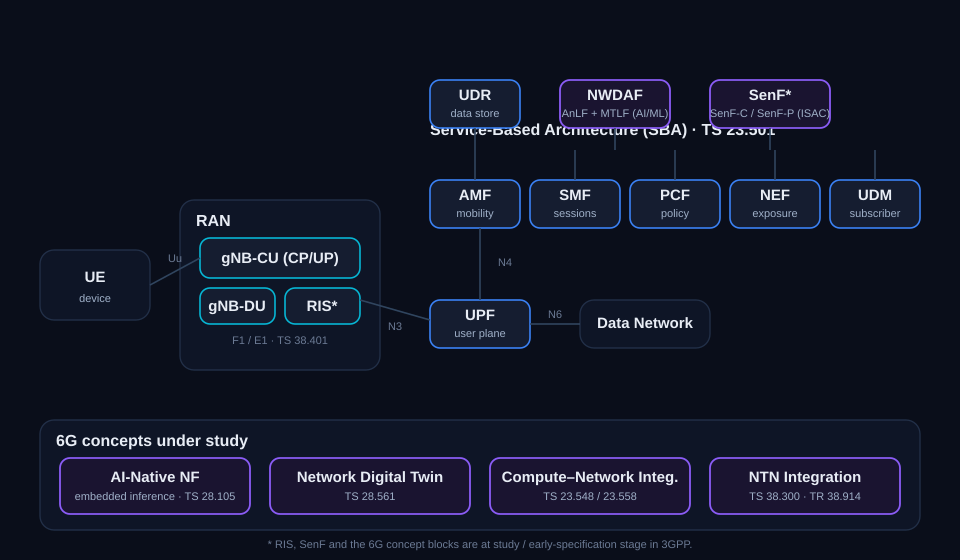

# 6G Network Architecture — Components Studied in 3GPP

This document describes the 6G network architecture components that 3GPP has **studied or is
currently studying**.

---

## Architecture overview

*Figure 1 — The service-based architecture (TS 23.501) with the network functions carried
forward toward 6G, the new/under-study functions (NWDAF, SenF, RIS), and the 6G concept
blocks (AI-native NF, Network Digital Twin, compute–network integration, NTN).*

---

## Part 1 — RAN side

*Figure 2 — The gNB CU/DU/RU functional split (TS 38.401), the baseline being evolved for 6G.*

### gNB (CU / DU / RU split)
The radio access node, already functionally split in 5G and carried forward for 6G. The
**gNB-CU** (Central Unit) hosts RRC, SDAP, and PDCP and connects to the core over NG; it is
further divided into **CU-CP** (control plane) and **CU-UP** (user plane) over the **E1**
interface. The **gNB-DU** (Distributed Unit) hosts RLC, MAC, and higher PHY, connected to the
CU over the **F1** interface. A lower-layer (7-2x) split to the **RU** is an implementation
option. For 6G, the sub-THz and AI-native radio studies (TR 38.914) consider further
disaggregation and how the access node connects to an AI-aware core. *References: TS 38.401,
TS 38.300; F1 (TS 38.470/473); E1 (TS 38.460/463).* **Status: specified in Rel-15+, evolving.**

### NTN payload / gateway
Extends the gNB to satellites and high-altitude platforms. The **NTN-Payload** provides the
NR radio link on the satellite/HAPS; the **NTN-Gateway** terminates the feeder link and
connects to the core via the standard NG interface; an **NTN Control Function** manages
ephemeris and timing compensation. This Rel-17/18 model is the baseline being evolved for 6G,
where terrestrial/non-terrestrial integration is a primary study topic in SA2 and RAN3.
*References: TS 38.300 §16.14, TS 38.101-5, TS 38.108.* **Status: specified Rel-17/18; 6G study.**

### RIS — Reconfigurable Intelligent Surface *
A surface whose electromagnetic response can be tuned to steer incoming radio waves toward a
chosen direction, redirecting signals without any active transmit chain. It is of interest for
filling coverage gaps, especially at sub-THz frequencies where propagation loss is high. An
open question in the study is whether a RIS needs its own standardised interface to the
gNB-CU/DU or can be treated purely as a deployment-level element; the network-controlled
repeater (TS 38.106) is an earlier related concept. RIS appears among the candidate 6G
technologies examined in TR 38.914. *References: TR 38.914 (study), TS 38.106 (repeater
precursor).* **Status: study / TR stage.**

---

## Part 2 — Service-based core network functions

All 5G Core functions are defined with service-based interfaces in TS 23.501 / TS 23.502 and
are being evolved toward 6G.

### AMF — Access and Mobility Management Function
The single entry point for UE access: it terminates NAS signalling (registration,
authentication, mobility), acts as the security anchor, manages idle-mode mobility and
paging, and holds UE context. Interfaces include N1 (UE), N2 (RAN), and links to SMF, UDM,
AUSF, and PCF. The 6G direction keeps the AMF as mobility anchor while deepening integration
with NWDAF for AI-driven mobility prediction and with the Sensing Function for location-aided
access. *References: TS 23.501 §6.2.6, TS 29.518.* **Status: Rel-15+, evolving.**

### SMF — Session Management Function
Manages the full PDU session lifecycle (establishment, modification, release), IP address
allocation, traffic-routing control, QoS enforcement toward the UPF (over N4/PFCP), and
charging triggers. The 6G study direction is compute-network integration, where session
management co-schedules data-plane and compute resources; edge computing (TS 23.548, via the
EASDF) is the precursor. *References: TS 23.501 §6.2.7, TS 29.502, TS 29.244.* **Status:
Rel-15+, evolving.**

### UPF — User Plane Function
The sole user-plane function: PDU session anchor, IP forwarding, packet inspection, QoS
marking and enforcement from SMF rules (PFCP), and local break-out for edge computing.
Interfaces: N3 (RAN), N9 (inter-UPF), N4 (SMF), N6 (data network). It is the primary target
for the 6G "compute-aware" data-plane study — routing to co-located compute without an extra
application hop. *References: TS 23.501 §6.2.8, TS 29.244.* **Status: Rel-15+, evolving.**

### NEF — Network Exposure Function
The secure gateway between network internals and external Application Functions: it exposes
northbound APIs (analytics, QoS, location, events) and enforces the trust boundary. In the 6G
context it gains prominence as the exposure point for sensing-as-a-service and AI/ML model
inference; TS 23.137 routes sensing results to external AFs via the NEF. *References:
TS 23.501 §6.2.11, TS 29.522.* **Status: Rel-15+, evolving.**

### PCF — Policy Control Function
The centralised policy function: session QoS policy (PCC rules to SMF), access/mobility
policy (to AMF), and UE policy (URSP). It uses the UDR for policy data and NWDAF analytics for
decisions. The 6G direction is AI-native policy, where rules are generated or adjusted from
real-time analytics rather than pre-provisioned (the NWDAF→PCF loop is already standardised).
*References: TS 23.501 §6.2.13, TS 23.503.* **Status: Rel-15+, evolving.**

### UDM — Unified Data Management
The subscriber data management layer: authentication credential generation (with AUSF),
subscription data management consumed by AMF/SMF/PCF, and UE context registration (which
AMF/SMF serves a UE). *References: TS 23.501 §6.2.14, TS 29.503.* **Status: Rel-15+.**

### UDR — Unified Data Repository
The converged data store underlying UDM, PCF, and NEF over the Nudr interface. It holds
subscription, policy, application, and structured data, separating data storage from the data
logic in UDM/PCF. *References: TS 23.501 §6.2.15, TS 29.504/29.505.* **Status: Rel-15+.**

### NWDAF — Network Data Analytics Function (AI/ML engine)
The AI/ML intelligence hub of the core. Its **AnLF** (Analytics Logical Function) performs
inference and produces statistics/predictions for NF and OAM consumers; its **MTLF** (Model
Training Logical Function) trains and distributes ML models, including to UEs and (via NEF) to
external AFs. It supports hierarchical multi-NWDAF deployments and draws data from UDM, PCF,
AMF, SMF, OAM, and the ADRF/DCCF. It is a central pillar of the 6G AI-native architecture, with
SA2 studying it as the system-wide AI/ML lifecycle function. *References: TS 23.288.* **Status:
Rel-15 inception, MTLF Rel-17/18, evolving.**

### SenF — Sensing Function * (new in Rel-20, ISAC)
A core function introduced for Integrated Sensing and Communication. It can be split into
**SenF-C**, which handles the control side (running sensing operations, authorization, picking
and discovering the gNBs involved, and provisioning parameters), and **SenF-P**, which collects
the raw measurements returned by one or more gNBs and turns them into sensing results. In this
model the gNB plays the role of **Sensing Entity**, reusing NR transmissions for radar-like
measurement. Results are delivered to AFs either directly or through the NEF; the Rel-20 work
centres on detecting and tracking airborne objects such as drones. *References: TS 23.137,
TS 22.137.* **Status: new NF, Rel-20.**

---

## Part 3 — New 6G architecture concepts (under study / early spec)

### AI-Native Network Function *
NFs with embedded ML inference (not merely consuming external NWDAF analytics) that can adapt
their behaviour from feedback loops and register their AI capabilities in the NRF for
discovery. The MTLF already enables model distribution to any NF; the SA2 6G study explores
whether the NF/AI-function distinction should collapse. TS 28.105 defines the OAM-side
management of AI/ML functions. *References: TS 23.288, TS 28.105.* **Status: Rel-18+ study.**

### Network Digital Twin (NDT) *
A digital stand-in for part or all of the network, kept in step with the live system so that
changes can be tried out against it rather than on production. Operators can rehearse
configuration changes, study how faults would propagate, and trial new services on the twin
before rollout; the twin may be realised through simulation, emulation, AI modelling, or a mix,
and it captures both the network layout and its performance behaviour. For 6G the NDT is
positioned as a near-real-time companion to management and control, feeding closed-loop
recommendations and drawing on NWDAF data and intent-based management (TS 28.312).
*References: TS 28.561.* **Status: Rel-18+, normative management spec.**

### Compute–Network Integration *
Co-design of computation scheduling and network session management. In 5G, SMF + UPF + EASDF
(TS 23.548) already provide compute-aware routing to edge nodes. The 6G study explores a
convergence function (or SMF/UPF extensions) that exposes compute-resource availability as a
first-class QoS parameter and schedules sessions with awareness of edge CPU/GPU — relevant to
XR, metaverse, and split rendering. *References: TS 23.548, TS 23.558.* **Status: Rel-17+,
6G study.**

### NTN Integration (6G perspective) *
Beyond the Rel-17/18 NTN baseline, 6G studies treat non-terrestrial access as an integral RAN
layer: direct-to-device satellite access, multi-orbit (GEO/MEO/LEO) coexistence, regenerative
payloads hosting a full gNB on orbit, and improved NTN-to-terrestrial handover (including
AI-assisted orbit prediction). *References: TS 38.300 §16.14, TR 38.914.* **Status: specified
Rel-17/18; 6G study topic.**

---

## Reference table

| Component | Role | 3GPP reference | Status |
|---|---|---|---|
| gNB (CU/DU/RU) | RAN node; CU-CP/CU-UP/DU split over F1/E1 | TS 38.401, 38.300 | Rel-15+, evolving |
| NTN payload/gateway | Satellite/HAPS radio + ground relay to core | TS 38.300 §16.14 | Rel-17/18; 6G study |
| RIS * | Passive reflective surface; channel manipulation | TR 38.914 | Study |
| AMF | UE registration, NAS, mobility, security anchor | TS 23.501 §6.2.6 | Rel-15+ |
| SMF | PDU session management, QoS, UPF control | TS 23.501 §6.2.7 | Rel-15+ |
| UPF | User-plane forwarding, break-out, detection | TS 23.501 §6.2.8 | Rel-15+ |
| NEF | External API exposure, sensing/AI exposure | TS 23.501 §6.2.11 | Rel-15+ |
| PCF | Policy control; AI-driven rules | TS 23.501 §6.2.13 | Rel-15+ |
| UDM | Subscription data, credentials, UE context | TS 23.501 §6.2.14 | Rel-15+ |
| UDR | Converged data store for UDM/PCF/NEF | TS 23.501 §6.2.15 | Rel-15+ |
| NWDAF (AnLF+MTLF) | AI/ML analytics and model training/distribution | TS 23.288 | Rel-15+, evolving |
| SenF (SenF-C/SenF-P) * | New ISAC core NF: sensing control/processing | TS 23.137, TS 22.137 | Rel-20 (new NF) |
| AI-Native NF * | NFs with embedded ML inference | TS 23.288, TS 28.105 | Rel-18+ study |
| Network Digital Twin * | Software replica for simulation/automation | TS 28.561 | Rel-18+ |
| Compute–Network Integration * | Co-schedule data plane + compute | TS 23.548, TS 23.558 | Rel-17+; 6G study |
| NTN Integration * | Integral non-terrestrial access layer | TS 38.300, TR 38.914 | Rel-17/18; 6G study |

---

