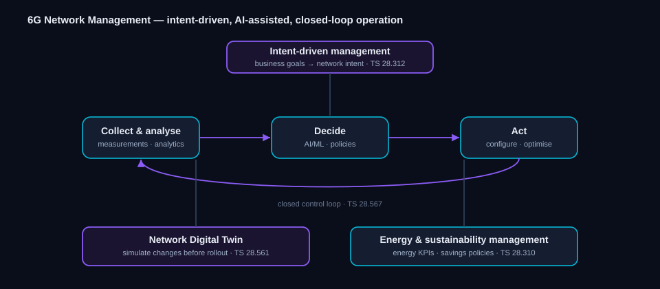

# 6G Network Management in 3GPP

Learn how 6G networks are meant to run themselves — the management and orchestration work in
3GPP that moves operations toward intent-driven, AI-assisted, closed-loop automation.

> **Status key:** *Study* = feasibility work. *Normative* = approved specification content.
> *Planned* = Rel-21 scope stated by 3GPP, not yet frozen.

---

## The management picture

*Figure 1 — Intent at the top drives a closed control loop (collect → decide → act), supported
by a network digital twin and energy management.*

6G networks are expected to be too large and dynamic for hands-on operation, so 3GPP's
management work (led by the service-and-system management group, SA5) centers on automation:
stating goals as intent, closing control loops with analytics and AI, rehearsing changes on a
digital twin, and treating energy as a managed resource. The pieces below already exist as
management specifications and are the foundation the 6G work builds on.

---

## Intent-driven management

Rather than configuring the network parameter by parameter, operators express what they want as
**intent** — high-level goals the management system then translates into configuration and keeps
satisfied as conditions change. This is the organizing idea for autonomous 6G operation.
*References: intent-driven management TS 28.312.* **Status: normative, evolving for 6G.**

---

## Closed control loops

Automation is structured as a loop: **collect and analyse** live measurements, **decide** using
policies and AI/ML, then **act** by reconfiguring or optimising the network — and repeat. The
loop is what turns intent into continuous, hands-off operation and is the backbone of
"zero-touch" management. *References: closed-loop automation TS 28.567; analytics feeds from the
core's data-analytics function.* **Status: normative, evolving for 6G.**

---

## Network Digital Twin

A **digital twin** is a live software copy of the network, kept in step with the real system
from ongoing measurements. Operators can rehearse configuration changes, study how faults would
spread, and trial new services on the twin before touching production. For 6G it is positioned
as a near-real-time companion to management and control, feeding the closed loop with
predictions. The twin may be realised through simulation, emulation, AI modelling, or a mix, and
captures both the network layout and its performance behaviour. *References: management of
network digital twins TS 28.561, work item NDT-OAM.* **Status: normative, active in Rel-20.**

---

## AI/ML in management

Management increasingly relies on machine learning — for traffic prediction, anomaly detection,
and optimisation decisions inside the control loop. 3GPP defines the management side of the AI/ML
functions themselves: how models are trained, deployed, monitored, and retired as part of
operations, complementing the core's analytics function. *References: AI/ML management TS 28.105;
network data analytics TS 23.288.* **Status: normative, evolving for 6G.**

---

## Energy and sustainability management

Energy efficiency is managed, not just hoped for. The management work defines energy-related
KPIs, measurement collection, and policies that drive savings — such as scheduling deeper
equipment sleep during low demand — and reports energy performance so sustainability goals can be
tracked. This connects directly to the radio-side green-RAN work. *References: energy-efficiency
management TS 28.310; the end-to-end KPI definitions it relies on in TS 28.554; and the
underlying performance measurements in TS 28.552.* **Status: normative, evolving for 6G.**

---

## Performance, assurance, and data

Underpinning all of the above is the management data plane: performance measurements, the
analytics data that loops consume, and the assurance that intent is actually being met. These
collection-and-assurance mechanisms are what let the automation measure its own success and keep
the network within its targets. *References: performance measurements TS 28.552; end-to-end KPIs
TS 28.554; management data analytics and assurance in the SA5 management specifications.*
**Status: normative, evolving.**

---

## Management specs and studies at a glance

| Spec / item | Area | Status |
|---|---|---|
| TS 28.312 | Intent-driven management | Normative |
| TS 28.567 | Closed-loop automation | Normative |
| TS 28.561 | Network digital twin management | Normative |
| TS 28.105 | AI/ML management | Normative |
| TS 28.310 | Energy-efficiency management | Normative |
| TS 28.554 | End-to-end KPIs (incl. energy-efficiency KPIs) | Normative |
| TS 28.552 | Performance measurements (PM counters) | Normative |
| TS 23.288 | Network data analytics (AI/ML) | Normative |

---
