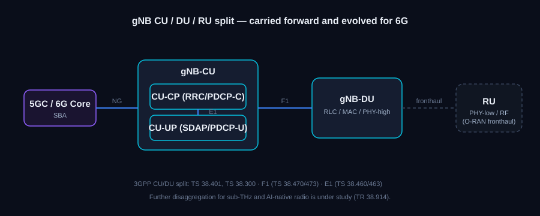

# 6G RAN — The Radio Access Network in 3GPP

Get to grips with the radio side of 6G — how the access network is expected to evolve in
3GPP across the Release 20 study phase and the planned Release 21 normative work.

> **Status key:** *Study* = Technical Report / feasibility work. *Normative* = Technical
> Specification with approved content. *Planned* = Rel-21 scope stated by 3GPP, not yet frozen.

---

## RAN architecture — the split carried forward

*Figure 1 — The 3GPP CU/DU split of the base station (the NR baseline evolved for 6G). The
radio unit and fronthaul are shown dashed because they belong to O-RAN, not 3GPP.*

The 6G base station is expected to keep the layered split already defined for NR, where the
central unit and distributed unit own different layers of the stack.

- **Central Unit (gNB-CU)** — hosts the higher layers (RRC, SDAP, PDCP) and connects to the
  core over the NG interface. It separates into a control-plane part and a user-plane part,
  linked over the **E1** interface.
- **Distributed Unit (gNB-DU)** — hosts RLC, MAC, and the higher physical layer, attached to
  the CU over the **F1** interface.

In 3GPP, the base-station architecture is the **CU/DU** split; the lower-layer fronthaul split
toward a separate radio unit is specified by the O-RAN Alliance rather than 3GPP, so it is out
of scope here. For 6G, the studies are examining whether the access node needs finer
disaggregation and how it should attach to an AI-aware core. *References: TS 38.401, TS 38.300;
F1 (TS 38.470 / TS 38.473); E1 (TS 38.460 / TS 38.463).*

---

## A new air interface

Release 21 is expected to introduce a new 6G radio rather than another increment of NR. A RAN
scenarios-and-requirements study sets the radio targets that this new interface must hit — very
high peak rates, strong edge performance, low latency and error rates, improved energy
efficiency, and high positioning accuracy — and frames the deployment scenarios the design has
to serve. The higher-level 6G usage scenarios come from the ITU-R IMT-2030 framework and from
3GPP's own SA1 service-requirements work. *References: 6G RAN study item (FS_6G_RAN); SA1
service requirements in the TS 22-series; ITU-R IMT-2030 framework.* **Status: study.**

---

## Candidate spectrum

Two new frequency regions are under examination as 6G candidates, alongside the existing
sub-7 GHz and mmWave bands:

- **Upper mid-band (roughly 7–24 GHz, "FR3")** — a balance of coverage and capacity for
  wide-area 6G, studied for wide carrier bandwidths with beam management tuned between the
  characteristics of the lower and higher 5G ranges.
- **Sub-THz (roughly 100–300 GHz)** — very wide bandwidths for extreme peak rates over short
  ranges, where severe path loss and different propagation behaviour call for near-field
  beamforming and new antenna structures.

*References: TR 38.914 and the 6G radio spectrum study, work item FS_6G_NR_spectrum.*
**Status: study.**

---

## Waveform and channel coding

As a reference point, 5G NR uses cyclic-prefix OFDM on the downlink (with a transform-precoded
variant on the uplink) and LDPC plus Polar channel coding (TS 38.211, TS 38.212). Whether 6G
keeps these waveform and coding choices, or departs from them — particularly for the sub-THz
bands — is still under discussion in 3GPP; no 6G waveform or coding scheme has been formally
agreed. **Status: open / under study (no 6G decision yet).**

---

## Massive MIMO and antennas

Antenna work builds on the Rel-18/19 massive-MIMO foundation toward 6G, including distributed
and cell-free arrangements, very large arrays, and near-field operation that becomes relevant
at higher frequencies. This feeds directly into the coverage strategy for the upper mid-band
and sub-THz. *References: 6G RAN study (TR 38.914), building on NR MIMO work.* **Status: study.**

---

## AI-native radio

Where 5G added AI/ML to specific radio functions, 6G studies making it a built-in design
principle across the physical layer (channel estimation, decoding), the MAC (scheduling), and
mobility. The work examines learned components, how AI models are provisioned and versioned to
devices with appropriate trust handling, and where inference should sit — in the device, the
DU, the CU, or the core — depending on latency and compute trade-offs. *References: 6G RAN AI
study, building on the Rel-18 AI/ML for NR air-interface study (TR 38.843).* **Status: study.**

---

## Integrated Sensing and Communication (ISAC) — radio aspects

The radio can serve double duty, carrying traffic while also taking radar-like measurements
from its own transmissions to detect and track objects. The radio-side work covers sensing
accuracy targets (range, velocity, angle), multi-target tracking, the monostatic and bistatic
sensing geometries, and keeping sensing and communication from degrading each other.
*References: requirements TS 22.137, architecture TS 23.137, radio design under the 6G RAN
study.* **Status: requirements normative, radio under study.**

---

## Reconfigurable Intelligent Surfaces (RIS)

A tunable surface can steer incident radio waves toward a chosen direction without an active
transmit chain, which is attractive for filling coverage gaps — especially at sub-THz, where
propagation loss is high. An open question is whether a RIS needs its own standardised
interface to the base station or can be treated as a deployment-level element; the
network-controlled repeater is an earlier related concept. *References: 3GPP RIS study item
(exact TR to be confirmed against the 3GPP work programme).* **Status: study.**

---

## Duplex and energy efficiency

Two further radio themes under study:

- **Flexible duplex** — including full-duplex operation (simultaneous transmit and receive on
  the same frequency) with self-interference cancellation, and more flexible time/frequency
  duplex arrangements.
- **Energy efficiency** — treated as a first-class radio design constraint, covering deeper
  base-station sleep modes, AI-driven traffic prediction for pre-emptive sleep, and
  energy-proportional operation, with management-side reporting of energy KPIs. *References:
  TR 38.914 scenarios, energy-efficiency management TS 28.310 / TS 28.552.* **Status: study
  (5G energy management normative).**

---

## RAN specs and studies at a glance

| Spec / item | Area | Status |
|---|---|---|
| FS_6G_RAN | 6G RAN study item | Study |
| ITU-R IMT-2030 + 3GPP SA1 (TS 22-series) | 6G usage scenarios & service requirements | Study / normative reqs |
| TR 38.843 | AI/ML for NR (foundation for AI-native radio) | Study (Rel-18) |
| 3GPP RIS study item | Reconfigurable Intelligent Surfaces (TR to be confirmed) | Study |
| TS 22.137 / TS 23.137 | ISAC requirements / architecture | Normative |
| TS 38.211 / TS 38.212 | NR waveform / channel coding (reference baseline) | Normative |
| TS 38.401, TS 38.300 | gNB CU/DU architecture and overall description | Normative (evolving) |
| TS 28.310, TS 28.552 | Energy-efficiency management / performance measurements | Normative |

---
